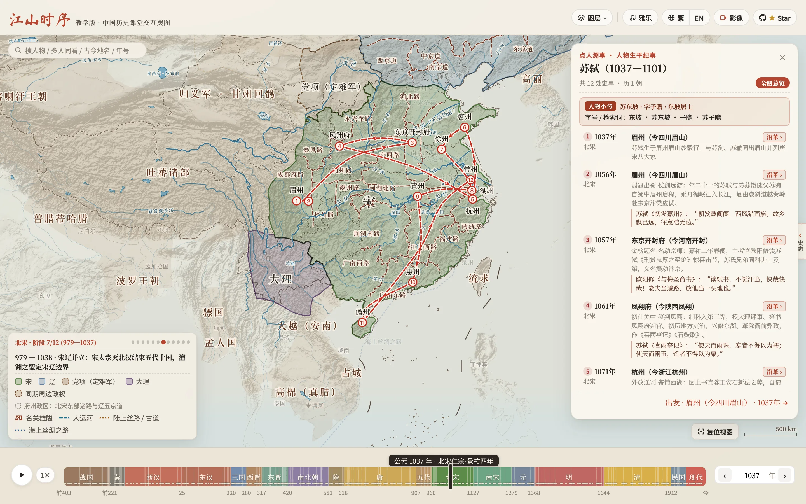
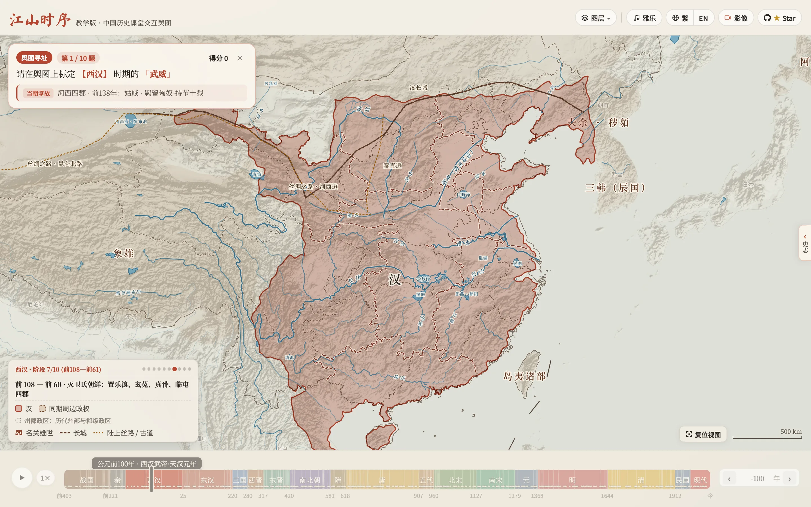

# 江山时序（教学版） · Chronicles of the Realm, Classroom Edition

**一幅可以拖动时间、点城读史、追随古人足迹的中国历史交互舆图，外加与统编版初中历史教材逐课对应的 86 课课件、688 题课堂题池、中西对照时间轴——零依赖、可私有部署的教学一体化产品。**

---

<p align="center">
  <picture>
    <source media="(prefers-color-scheme: dark)" srcset="assets/hero_demo_en.webp" />
    
  </picture>
</p>

<p align="center">
  <table>
    <tr>
      <td><picture><source media="(prefers-color-scheme: dark)" srcset="assets/preview_741_tang_trace_en.webp" /></picture></td>
      <td><picture><source media="(prefers-color-scheme: dark)" srcset="assets/preview_1415_ming_yingtian_en.webp" /></picture></td>
    </tr>
    <tr>
      <td><picture><source media="(prefers-color-scheme: dark)" srcset="assets/preview_journey_sushi_en.webp" /></picture></td>
      <td><picture><source media="(prefers-color-scheme: dark)" srcset="assets/preview_quiz_challenge_en.webp" /></picture></td>
    </tr>
  </table>
</p>

---

## 一、产品组成

| 模块 | 说明 | 入口 |
|---|---|---|
| **交互舆图** | 公元前 403 年（三家分晋）至现代，18 个历史时期的多阶段疆域与州郡政区、历代古城、天下名关、诗词名胜与古战场、编年大事、帝王年号纪年；中英繁三语 | `/` |
| **课件播放器** | 86 课与统编版教材逐课对应（七上 21 · 七下 22 · 八上 22 · 八下 17 · 学史方法 3 · 中考专题 1），每课分幕播放 + 课堂快测 | `/classroom/` |
| **舆图寻址题池** | 688 题 / 86 课，随机抽题、限时挑战、错题重做与导出 | `/classroom/bank` |
| **中西对照时间轴** | 前 8 世纪至 21 世纪逐世纪分栏，中外大事并列，可打印复习单 | `/classroom/compare` |
| **用户账号与站长统计** | 单一用户体系，登录保存个人设置；站长可查用户数与邮箱 | `/classroom/login`、`/classroom/admin` |

课件、题池、中西对照**无需登录**即可使用；账号仅用于保存个人设置。

## 二、舆图能做什么

- **拉动时间轴看天下分合**：从战国七雄并立到汉末群雄、南北朝、五代十国与宋辽夏金蒙，多政权同屏高亮；重大开疆失地节点（灭巴蜀、平辽东、置安西四镇、设宣政院、收复伊犁、台湾光复……）点击即切换版图，并浮现上一阶段朱砂虚线残影；当朝在位帝王与年号实时内联显示。
- **点开任意城池读两千年身世**：「点地溯源」卡片呈现名城判词、从郡县到行省再到现代省市的完整沿革，内嵌定点大事（商鞅变法、水淹七军、玄武门之变……），点击事件即穿越回那一年；函谷关、潼关、剑门关等 20 座名关附山川形势详解。
- **点人溯事重走青史路**：搜任意帝王将相与文豪名僧，在版图上以游丝弧线展开一生行迹——秦始皇扫六合、张骞凿空西域、诸葛亮北伐、玄奘西行、李白壮游、苏轼贬谪、王阳明立功立言，地图与年号随古人脚步同步流转。
- **舆图寻址挑战**：隐去城池标注，凭山水直觉在古舆图上盲猜扎针，按得分授予「太史令 · 舆图大家」等传统官阶封号。

舆图支持 `?year=<年份>&place=<地名>&person=<人物>` 深链直达任意历史瞬间，课件即基于该协议内嵌驱动。

### 嵌入到你的网页 / 校园平台

把舆图的任意画面放进博客、Notion 或学校课程网站：

1. 打开舆图，调到想展示的画面（某一年、某地点卡片或某人物轨迹），地址栏会实时反映当前画面。
2. 在网址后追加 `&embed=1` 进入嵌入模式（隐藏站点级导航，只保留舆图本体）。
3. 放进 `<iframe>`，例如嵌入苏轼行迹（限定 1072–1126 年）的写法：

```html
<iframe src="/?person=sushi&embed=1&from=1072&to=1126"
        width="100%" height="520" loading="lazy" title="江山时序（教学版）历史舆图"></iframe>
```

## 三、三分钟跑起来

```bash
# 方式一：本地直接跑（需要 Node ≥ 22，用到内置 node:sqlite）
npm start                  # → http://localhost:8090/classroom/

# 方式二：Docker（不想装 Node）
docker compose up -d --build jiangshan-classroom

# 方式三：纯静态试用（无账号功能，课件题池照常可用）
python3 -m http.server 8000    # → http://localhost:8000/classroom/
```

## 四、怎么上一节课（完整流程）

### 1. 备课

1. 打开 `/classroom/`，左侧教材树按 **学段 → 册 → 单元 → 课** 找到本节课；也可用链接直达，如 `classroom/?lesson=q7s-u1-l01`（七上第 1 课）。
2. 通读各幕旁白与板书要点，确认与你的教学设计吻合。
3. 需要微调？点右上「**自定义**」进入自定义模式：可隐藏个别场景、改写旁白——修改自动存本机（localStorage），还能导出 JSON 备份或分享给同事。

### 2. 上课

1. 上课前点右上「**A±**」把字号调到适合教室后排；再点「**投屏**」进入全屏大字模式。
2. 用**翻页笔（PageUp/PageDown）**或方向键、空格键翻幕——完全不用碰鼠标。
3. 每幕都是三种形态之一：**地图定格**（讲空间）、**人物行迹巡礼**（讲过程）、**时间轴演进**（讲脉络）。讲到「红军长征」「丝绸之路」这类空间叙事课时，路线会在舆图上逐步展开。
4. 需要地图细节时，课件内的地图可平移缩放；也可暂停播放，点开任意城池看「点地溯源」。
5. 讲完进入「**课堂快测**」：8 道选择题当堂检测，答错即时给解析并一键回跳地图对应位置。

> 课上小工具：右上「**工具箱**」里有年号纪年换算、公元年 → 世纪、跨公元前后的年数计算，随用随开。

### 3. 课后练习

1. 打开 `/classroom/bank`（舆图寻址题池），按册、单元、课或关键词筛选本章题目。
2. 三种练法：**顺序练习** / **随机 10 或 20 题** / **限时挑战**（每题 30 秒）。
3. 答错的题进入错题本，可一键「错题重做」；答过的题能「回看地图」定位史实；错题可导出 JSON 带走。

### 4. 复习与备考

- **中西对照时间轴**（`/classroom/compare`）：九年级复习利器——前 8 世纪到 21 世纪逐世纪分栏，中国朝代与世界大事并列，支持检索、年份跳转、键盘翻阅，还能直接打印成复习单。
- **学史方法三课**：《如何阅读历史地图》《如何掌握历史纪年法》《如何从出土文物中获取信息》，对标新课标探究活动。
- **中考专题**：《两千年疆域：从秦到清》跨册串讲，专攻「地图型」选择题的四大设问套路。

### 5. 自学模式（复习模式）

课件链接后加 `?mode=student`（如 `classroom/?lesson=q8s-u5-l14&mode=student`）即进入**复习模式**：隐藏备课功能，把链接发出去，谁拿到都能自主看课件、做快测。

## 五、账号与站长统计

- **注册/登录**：`/classroom/login`。用户名 + 姓名 + 邮箱（必填）+ 密码；密码加盐哈希存储，会话为 HttpOnly Cookie（7 天）。登录后可改密码（改密会吊销全部旧会话）。
- **站长统计**：`/classroom/admin`。输入 `ADMIN_TOKEN` 口令进入，可看总用户数、今日新增、活跃会话和用户列表（含邮箱）。口令通过环境变量/secret 设置，不进代码库。
- 隐私底线：不记 IP/UA/指纹，统计只有聚合计数，拿不到任何答题明细。

## 六、部署到线上

| 目标 | 做法 |
|---|---|
| 自己电脑/机房内网 | `npm start` 或 `docker compose up -d` |
| 云主机 + 域名 HTTPS | Node systemd 服务 + nginx 反代 + certbot，配置文件已备好：[`deploy/`](deploy/) |
| Cloudflare Pages（免服务器、免运维） | `npm run deploy`，API 跑在 Pages Functions，数据存 D1，配置见 `wrangler.toml` |

云主机部署要点（完整命令参考 [`deploy/nginx-jiangshan.conf`](deploy/nginx-jiangshan.conf) 头部注释）：

- Node 必须 **≥ 22**；
- `COOKIE_SECURE=1` 只在 HTTPS 下用，裸 http 调试时改 `0`；
- 数据库是单个 SQLite 文件（云主机在 `/var/lib/jiangshan/app.db`），`cp` 一下即完成备份。

环境变量：`PORT`（默认 8090）、`DB_PATH`（默认 `server/data/app.db`，已 gitignore）、`COOKIE_SECURE`、`ADMIN_TOKEN` 站长统计口令（不设则统计端点返回 404）。

## 七、扩展与维护

```bash
# 新增/修改课件剧本：在 classroom/data/lessons/ 按 Schema 写 JSON，
# 并在 classroom/data/manifest.json 登记，然后校验：
node classroom/validate_lessons.cjs

# 修改题目后重建题库与服务端答案表（688 题索引）：
node scripts/build_answers.cjs

# 忘了某用户密码（本地 Node 版）：
node scripts/reset_teacher_password.js <用户名>
# Cloudflare D1 版：
node scripts/cf_reset_teacher_password.mjs <用户名>
```

课件剧本规范：每课恰好 8 道快测题（识记 4 / 理解 2 / 材料情境 2），每幕旁白 150–220 字、板书 3–6 条，场景的 `type/title/link`（地图年份与地名锚点）不可改。样板见 `classroom/data/lessons/q7s-u1-l01.json`。

贡献指南见 [CONTRIBUTING_ZH.md](CONTRIBUTING_ZH.md)（中文）与 [CONTRIBUTING.md](CONTRIBUTING.md)（English）。
