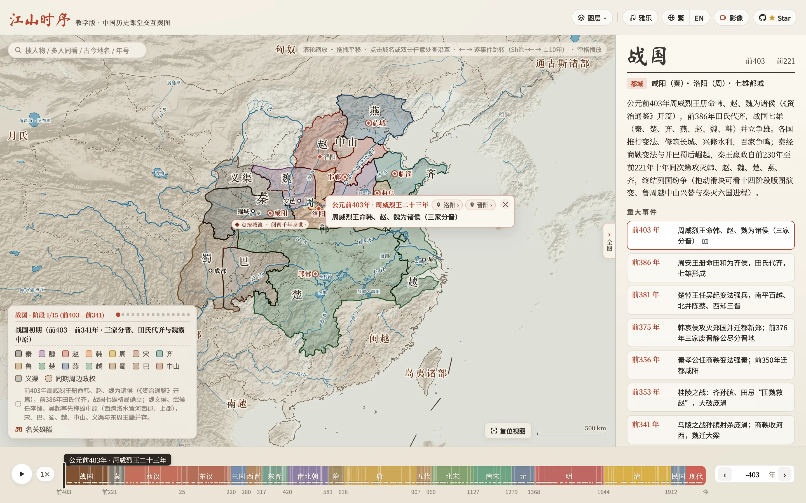
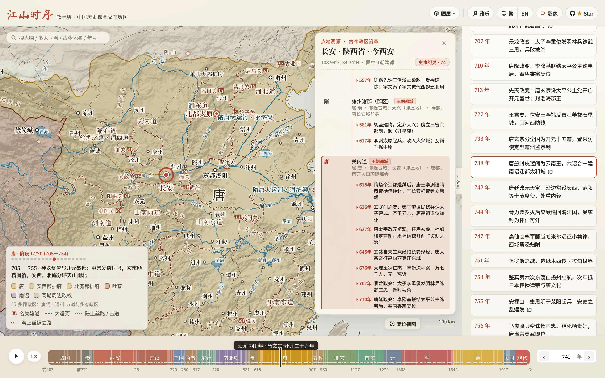
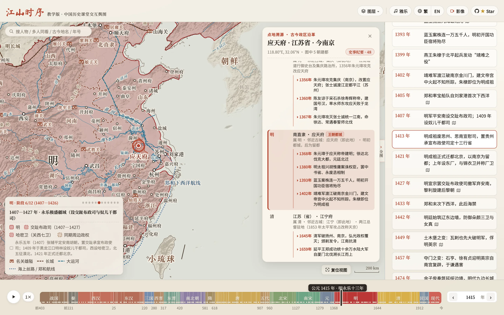

# 江山时序（教学版） · Chronicles of the Realm, Classroom Edition

**给孩子的可拖动中国历史舆图 + 给老师的 86 课教材同步课件与 688 题题池——零依赖、可私有部署。**

家长用它陪孩子「点城读史、看疆域流转」；历史老师用它 10 分钟备好一节地图课、投屏上课、当堂快测。孩子收获的是**空间感 + 时间轴 + 真实地图题能力**，而不是又一个大而全的刷题APP。

---

<p align="center">
  <picture>
    <source media="(prefers-color-scheme: dark)" srcset="assets/hero_demo_en.webp" />
    
  </picture>
</p>

<p align="center">
  <table>
    <tr>
      <td><picture><source media="(prefers-color-scheme: dark)" srcset="assets/preview_741_tang_trace_en.webp" /></picture></td>
      <td><picture><source media="(prefers-color-scheme: dark)" srcset="assets/preview_1415_ming_yingtian_en.webp" /></picture></td>
    </tr>
    <tr>
      <td><picture><source media="(prefers-color-scheme: dark)" srcset="assets/preview_journey_sushi_en.webp" /></picture></td>
      <td><picture><source media="(prefers-color-scheme: dark)" srcset="assets/preview_quiz_challenge_en.webp" /></picture></td>
    </tr>
  </table>
</p>

---

## 一、家长：孩子能收获什么，你怎么陪TA用

### 孩子能收获的四样东西

1. **空间地理思维**——历史考试的「地图题」丢分，本质是孩子脑子里没有地图。在舆图上亲眼看见秦国怎么一步步吞并六国、大运河怎么把南北连起来，「在地图上记住的历史」一辈子忘不掉。
2. **完整的时间轴**——从公元前 403 年三家分晋到今天，18 个时期拖一下就过：朝代顺序、前后关系不再是背口诀，而是「亲眼看过版图此消彼长」。
3. **古今地名对照能力**——孩子问「长安是现在的哪里？」，点开「点地溯源」卡片：西安从郡县到行省的完整身世、发生在长安的大事件，一屏讲清。这是课本给不了的高频考点能力。
4. **主动探索的兴趣**——「点人溯事」追着苏轼的贬谪路线走一遍中国，比背生平简介有趣得多；「舆图寻址挑战」盲猜扎针得分封官，孩子会主动玩。

### 家长怎么用（三个典型场景）

| 场景 | 你做什么 | 用哪个功能 |
|---|---|---|
| **孩子来问历史问题** | 「安史之乱是在哪儿打的？」→ 在舆图上搜城池、点开大事卡片，地图直接跳到那一年，边看边讲 | 舆图检索 + 点地溯源 |
| **周末 20 分钟亲子共学** | 打开一节课件（如七上第 1 课），像看动画一样陪孩子过一遍，每课末尾 8 道快测题当场检验 | `/classroom/` |
| **考前冲刺** | 把课件复习链接（`?mode=student`）发到孩子平板自主过一遍；再用题池错题重做；最后对照中西时间轴梳理大脉络 | 复习模式 + 题池 + 中西对照 |

> 不用注册、不用安装，浏览器打开就能用；账号只在你想保存个人设置时才需要。

## 二、历史老师：能省什么时间，能上出什么效果

### 你能收获的

1. **备课从「做PPT」变成「选课 + 微调」**——86 课课件与统编版初中历史教材逐课对应（七上 21 · 七下 22 · 八上 22 · 八下 17 · 学史方法 3 · 中考专题 1），每课 8 幕剧本 + 板书要点现成；点「自定义」可改旁白、隐藏场景，改完存本机还能导出 JSON 分享给同备课组。
2. **课堂效果**——投屏全屏大字模式 + 翻页笔翻幕，双手离开鼠标专注讲课；讲到长征、丝绸之路这类空间叙事，路线在舆图上逐步展开，比静态地图册直观一个量级。
3. **当堂检测闭环**——每课末尾 8 道快测（识记 4 / 理解 2 / 材料情境 2），答错即时解析并**一键回跳地图对应位置**：错的不是答案而是空间观念，当场修正。
4. **课后与备考弹药**——688 题题池按册/单元/课筛选，三种练法 + 错题本 + 一键导出；《两千年疆域：从秦到清》中考专题专攻「地图型」选择题设问套路；中西对照时间轴九年级复习直接打印。

### 一节课怎么上（完整流程）

**备课（约 10 分钟）**

1. 打开 `/classroom/`，教材树按 **学段 → 册 → 单元 → 课** 定位，或用链接直达：`classroom/?lesson=q7s-u1-l01`（七上第 1 课）。
2. 通读各幕旁白与板书，确认与你的教案吻合；需要改就进「**自定义**」模式微调——修改自动存本机（localStorage）。

**上课（40 分钟）**

1. 课前点「**A±**」把字号调到教室后排可读，点「**投屏**」进全屏大字模式。
2. 翻页笔（PageUp/PageDown）或空格键翻幕——完全不用碰鼠标；每幕是三种形态之一：**地图定格**（讲空间）、**人物行迹巡礼**（讲过程）、**时间轴演进**（讲脉络）。
3. 需要展开时暂停，课件内地图可平移缩放，点开任意城池看「点地溯源」。
4. 讲完进入「**课堂快测**」：8 题当堂检测，答错即时解析并回跳地图。

> 右上「**工具箱**」随用随开：年号纪年换算、公元年 → 世纪、跨公元前后的年数计算。

**课后练习**

1. `/classroom/bank` 题池按册、单元、课或关键词筛题：**顺序练习** / **随机 10 或 20 题** / **限时挑战**（每题 30 秒）。
2. 错题自动进错题本，一键「错题重做」；每道题都能「回看地图」定位史实；错题可导出 JSON 带走。

**复习与备考**

- `/classroom/compare` 中西对照时间轴：前 8 世纪至 21 世纪逐世纪分栏、中外大事并列、可检索可打印，九年级复习利器。
- 学史方法三课：《如何阅读历史地图》《如何掌握历史纪年法》《如何从出土文物中获取信息》，对标新课标探究活动。
- 复习模式：课件链接加 `?mode=student`（如 `classroom/?lesson=q8s-u5-l14&mode=student`）即隐藏备课功能，把链接发出去，谁拿到都能自主看课件、做快测。

## 三、舆图本体：四个玩法

- **拉动时间轴看天下分合**：战国七雄到汉末群雄、南北朝、五代十国与宋辽夏金蒙，多政权同屏高亮；重大开疆失地节点（灭巴蜀、平辽东、置安西四镇、设宣政院、收复伊犁、台湾光复……）点击即切换版图，上一阶段以朱砂虚线残影对照；在位帝王与年号实时内联显示。
- **点地溯源**：点开任意城池读两千年身世——名城判词、从郡县到行省再到现代省市的沿革、定点大事（商鞅变法、水淹七军、玄武门之变……），点击事件即穿越回那一年；函谷关、潼关、剑门关等 20 座名关附山川形势详解。
- **点人溯事**：搜帝王将相与文豪名僧，一生行迹以游丝弧线在版图上展开——秦始皇扫六合、张骞凿空西域、诸葛亮北伐、玄奘西行、李白壮游、苏轼贬谪、王阳明立功立言，地图与年号随古人脚步同步流转。
- **舆图寻址挑战**：隐去城池标注，凭山水直觉在古舆图上盲猜扎针，按得分授予「太史令 · 舆图大家」等传统官阶封号。

舆图支持 `?year=<年份>&place=<地名>&person=<人物>` 深链直达任意历史瞬间，课件即基于该协议内嵌驱动。

### 嵌入到你的网页 / 校园平台

把舆图任意画面放进博客、Notion 或学校课程网站：

1. 打开舆图调到想展示的画面（某一年、某地点卡片或某人物轨迹），地址栏会实时反映当前画面。
2. 网址后追加 `&embed=1` 进入嵌入模式（隐藏站点级导航，只保留舆图本体）。
3. 放进 `<iframe>`，例如嵌入苏轼行迹（限定 1072–1126 年）的写法：

```html
<iframe src="/?person=sushi&embed=1&from=1072&to=1126"
        width="100%" height="520" loading="lazy" title="江山时序（教学版）历史舆图"></iframe>
```

## 四、三分钟跑起来

```bash
# 方式一：本地直接跑（需要 Node ≥ 22，用到内置 node:sqlite）
npm start                  # → http://localhost:8090/classroom/

# 方式二：Docker（不想装 Node）
docker compose up -d --build jiangshan-classroom

# 方式三：纯静态试用（无账号功能，课件题池照常可用）
python3 -m http.server 8000    # → http://localhost:8000/classroom/
```

## 五、账号与站长统计（给自建部署的管理者）

- **注册/登录**：`/classroom/login`。用户名 + 姓名 + 邮箱（必填）+ 密码；密码加盐哈希存储，会话为 HttpOnly Cookie（7 天）。登录后可改密码（改密会吊销全部旧会话）。课件、题池、中西对照**无需登录**即可使用；账号仅用于保存个人设置。
- **站长统计**：`/classroom/admin`。输入 `ADMIN_TOKEN` 口令进入，可看：注册用户（含邮箱、最近登录、登录次数）、近 7 日访客与浏览量、近 14 天浏览趋势、热门课件与最近行为流水。口令通过环境变量/secret 设置，不进代码库。
- **隐私边界**：页面访问与课件打开等事件会匿名上报（随机 cookie 区分访客，登录用户自动关联账号）；不采集 IP、浏览器指纹或答题明细，数据只存自己的库、只给站长看。

## 六、部署到线上

| 目标 | 做法 |
|---|---|
| 自己电脑/机房内网 | `npm start` 或 `docker compose up -d` |
| 云主机 + 域名 HTTPS | Node systemd 服务 + nginx 反代 + certbot，配置文件已备好：[`deploy/`](deploy/) |
| Cloudflare Pages（免服务器、免运维） | `npm run deploy`，API 跑在 Pages Functions，数据存 D1，配置见 `wrangler.toml` |

云主机部署要点（完整命令参考 [`deploy/nginx-jiangshan.conf`](deploy/nginx-jiangshan.conf) 头部注释）：

- Node 必须 **≥ 22**；
- `COOKIE_SECURE=1` 只在 HTTPS 下用，裸 http 调试时改 `0`；
- 数据库是单个 SQLite 文件（云主机在 `/var/lib/jiangshan/app.db`），`cp` 一下即完成备份。

环境变量：`PORT`（默认 8090）、`DB_PATH`（默认 `server/data/app.db`，已 gitignore）、`COOKIE_SECURE`、`ADMIN_TOKEN` 站长统计口令（不设则统计端点返回 404）。

## 七、扩展与维护

```bash
# 新增/修改课件剧本：在 classroom/data/lessons/ 按 Schema 写 JSON，
# 并在 classroom/data/manifest.json 登记，然后校验：
node classroom/validate_lessons.cjs

# 修改题目后重建题库与服务端答案表（688 题索引）：
node scripts/build_answers.cjs

# 忘了某用户密码（本地 Node 版）：
node scripts/reset_teacher_password.js <用户名>
# Cloudflare D1 版：
node scripts/cf_reset_teacher_password.mjs <用户名>
```

课件剧本规范：每课恰好 8 道快测题（识记 4 / 理解 2 / 材料情境 2），每幕旁白 150–220 字、板书 3–6 条，场景的 `type/title/link`（地图年份与地名锚点）不可改。样板见 `classroom/data/lessons/q7s-u1-l01.json`。

贡献指南见 [CONTRIBUTING_ZH.md](CONTRIBUTING_ZH.md)（中文）与 [CONTRIBUTING.md](CONTRIBUTING.md)（English）。
